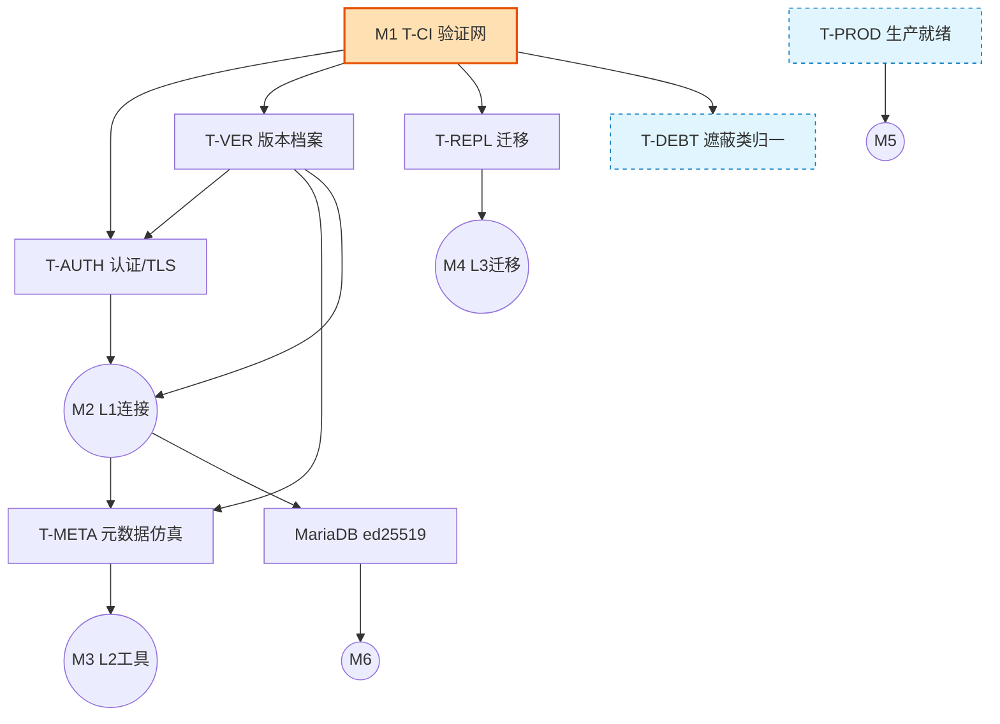

# Mycat2 × MySQL/MariaDB LTS 兼容性路线图 — 设计文档

- 状态：**已批准（2026-10-01 用户评审通过并预批执行口径；原 2026-09-30 Draft for Review）**，实施状态见 PROGRESS 看板
- 日期：2026-09-30
- 作者：架构评审修正落地（承接 `architecture-review-20260930-mycat2-full.html` 的复审结论 D11-D14）
- 目标一句话：让 Mycat2 成为**在客户端眼中可无缝替代 MySQL 5.7 / 8.0 / 8.4(LTS) / 9.x(Innovation)、并为 MariaDB 10.6/10.11/11.4(LTS) 预留扩展位**的强大代理中间件。

> 本文档遵循用户既定原则：**任何"完成/已修复"判定只认当前代码 `file:line` 与 CI/测试实证输出，不认自述记录**。因此每个工作项的 `Done` 门都是**可客观运行的检查**，状态由 CI 派生，不由人填。

---

## ★ 验收标准（Definition of「支持某后端版本 V」）

> **本节性质**：把 §1.1（目标范围）+ §3（里程碑出口判据）+ §5（Evidenced-Done 定义）合成**一页可勾检的验收尺**。它是导航、不是新事实源——**任何口径冲突以 §3 / §5 为准**。实时进度见 `DEBT-QUEUE.md` 顶部仪表盘。

**一句话定义**：说 Mycat2「支持版本 V」，当且仅当——**spec 点名的验收面里，V 对应的每一格兼容性矩阵都在可重跑的 CI 上为绿**（M2 连接达标 + M3 工具达标 + M4 迁移达标；V 属 MariaDB 时再加 M6）。**验收单位 = 兼容性 harness 的逐格矩阵，不是全仓测试类总数。**

### 逐格矩阵 = `connector × 认证插件 × TLS on/off × 操作`，按版本 V 展开
- **connector 集**（§1.1）：Connector/J 5.1/8.x/9.x · Go `go-sql-driver` · Python `mysqlclient/PyMySQL` · C/.NET
- **认证插件**：`mysql_native_password` + V 的默认插件（MySQL 8.x/9.x = `caching_sha2_password`；MariaDB = `client_ed25519`，属 M6）
- **TLS**：on / off 两态（含非 TLS 下 caching_sha2 的 RSA 公钥检索）
- **操作**：连接后完成**基本 CRUD**（增删改查 + 结果集保真），非穷举 SQL 特性

### 三态判定（与 harness 图例一致）
| 态 | 含义 |
|---|---|
| **PASS** | 该格达标 |
| **N/A** | 后端客观无此能力（如 5.7 无 caching_sha2）——合法不支持，**≠ 失败** |
| **FAIL / ERROR** | 真缺口，须专轮修 |
| **NO_DATA** | 该格未跑出（驱动/构建异常）——**响，不得静默当绿** |

### 每版本 V 的验收清单（勾满才算「支持 V」）
- [ ] **M2 连接达标**：上述矩阵对 V 逐格 PASS（或合法 N/A），含 caching_sha2 + TLS on/off，**全 connector**（非只 Connector/J）。
- [ ] **M3 工具达标**：`mysqldump <db>` 结构+数据产物能在**原生 V 回灌成功**（往返进 harness）；主流 GUI（DBeaver/Navicat）能列库列表。
- [ ] **M4 迁移达标**：`MIGRATE_*`/`BINLOG_*` hint 链在 V 上矩阵绿。
- [ ] **M6（仅 MariaDB）**：profile + `client_ed25519`（后端多驱动 I-AU-6）绿。**MySQL 各版本无此项。**

### 三条铁则（防"测试总数全绿≈达标"的误解）
1. **地基护栏 = 必要不充分**：全仓单测（hbt/router/server/common/config/executor）+ example 功能全量须保持绿，证明"没弄坏引擎"；**但它们绿 ≠ 支持 V**。任一由绿转红触发 §5 **Regressed** → 自动打回，进度不得假性前进。
2. **缺格须补，但守最小必要面**：凡验收面点名却无对应用例（当前缺：**TLS 轴 / CRUD 操作轴 / 元数据-dump 往返轴 / 迁移轴 / 多 connector 轴**）= 网有洞，补之；**不追求穷尽 MySQL 特性全集**（§6 R5：以往返实际查询集界定）。
3. **Evidenced-Done 硬门**：某格判 Done 必须有**一条可重跑的自动化检查当前为绿** + 记录最近绿的平台版本；**禁止仅凭 commit message 或口头判 Done**（§5）。

> **多 connector 硬边界（须知道）**：兼容性 harness 住在 `example/.../compat/`（Java 模块，连 8066 打真实后端），**Java 测不了 Go/Python/.NET/C 原生客户端**。这一轴**超出 example 能力**，需另立 polyglot/docker 客户端冒烟网（I-DEBT-9「多 connector 矩阵」缺口）；在此之前，M2 的"全 connector"对非 Java connector 记 **NO_DATA（未覆盖）**，不得当 PASS。

---

## 0. 事实校准（写文档前重新取证，推翻评审若干默认）

| 项 | 评审默认 | 当前实证 | 对计划的影响 |
|---|---|---|---|
| 依赖现代化 | "需在 JDK21 上升依赖" | 根 pom 已是 Connector/J **9.3.0**、Calcite 1.42.0、Vert.x 4.5.14、Druid 1.2.28、JDK 21（`pom.xml:43-66`） | **"升级依赖"维度基本取消**，重心转向前端能力补齐 |
| 前端认证工作量 | "D11 前端认证矩阵缺失" | 握手只宣称 `mysql_native_password`（`MySQLClientAuthHandler.java:260`），但 `checkPassword` **已同时校验 native 与 caching_sha2 scramble**（`:275-281`） | caching_sha2 校验原语已在，缺的是**完整协商（fast/full-auth + RSA/TLS）**，工作量比"从零写"小 |
| 前端 TLS | 未评估 | 全仓前端无 TLS 路径，仅后端 `ConnectHandler.java:170 upgradeToSsl`；`CLIENT_SSL` 前端被注释 | TLS 是**净新增能力**，非清理 |
| 版本自述 | D12 硬编码 | `ServerConfig.java:64 "5.7.33-mycat-2.0"`；握手用 `MySQLVersion.SERVER_VERSION` 硬编码（`:251`） | 需版本档案（profile）替换 |
| EOF 能力 | — | `NewMycatConnectionConfig.CLIENT_DEPRECATE_EOF` 是 `public static boolean`（`:6`），启动期全局写、连接期读 | 需收敛为连接级/按 profile |
| MariaDB | 目标待纳入 | 后端已有 `NewMariadbConnectionImpl`；前端 ed25519 无 | 后端有地基，前端认证是缺口 |

**结论**：这是一份"**以前端能力补齐为主、依赖已基本就位**"的兼容性工程，不是大重构。最大风险不是改动量，而是**当前没有任何 CI 验证网**（D13），导致任何改动无法判定"没弄坏别的版本"。故 Track-CI 是所有其它维度的前置。

---

## 1. 目标与非目标

### 1.1 目标（承诺范围）
- **L1 连接与认证兼容**：主流 connector（Connector/J 5.1/8.x/9.x、Go go-sql-driver、Python mysqlclient/PyMySQL、C/.NET）在 5.7→9.x 的默认认证与 TLS 策略下均能连上 Mycat2 并完成基本 CRUD。
- **L2 运维工具兼容**：mysqldump 能对 Mycat2 做结构+数据导出并可回灌；主流 GUI（DBeaver/Navicat）能列库列表。方式=**版本自述 + 元数据仿真**，不追求变成 MySQL 内核。
- **L3 在线迁移能力**：现有 `MIGRATE_*` / `BINLOG_*` hint 族（`HintHandler.java:601-762`、`MigrateUtil`、`BinlogUtil`）作为"数据搬家"工序保持正确并**纳入 CI 矩阵**。
- **扩展位**：为 MariaDB 10.6/10.11/11.4 预留版本档案与认证插件位（ed25519）。

### 1.2 非目标（明确排除，防 scope creep）
- **N1 代理作为复制主库**：不实现 `COM_BINLOG_DUMP`/`CLIENT_MASTER`（当前仅常量定义 `MySQLCommandType.java:120`、无 handler，`CommandDispatcher` 无对应方法）。与 MyCat1/ProxySQL/ShardingSphere 一致。下游 CDC 请在物理分片层各接 Canal/Flink CDC。
- **N2 InnoDB 内核职责**：存储引擎、真正的事务隔离、备份锁、GTID 生成——由物理库承担。
- **N3 MySQL Shell AdminAPI / InnoDB Cluster**：不仿真 `\cluster`、`replication_metadata`。
- **N4 对外 CDC 订阅产品化**：L3 的 binlog 能力仅服务内部迁移，不作对外卖点。

---

## 2. 维度（Track）组织

每个 Track 独立可读、可测、可标状态。ID 命名 `T-<域>`，项 `I-<域>-<序>`。

| Track | 名称 | 验收面 | 与其它 Track 关系 |
|---|---|---|---|
| **T-CI** | 验证网 / CI 矩阵 | L1-L3 的客观证明来源 | **前置**，被所有 Track 依赖 |
| **T-AUTH** | 连接与认证层 | L1 | 依赖 T-CI 出证；TLS 子项依赖 T-VER |
| **T-VER** | 版本自述与能力矩阵 | L1/L2 | 被 T-AUTH、T-META 依赖 |
| **T-META** | 元数据仿真层 | L2 | 依赖 T-VER |
| **T-REPL** | 复制 / 迁移层 | L3/N1 | 依赖 T-CI |
| **T-PROD** | 生产就绪 | 运行稳健 | 独立，可并行 |
| **T-DEBT** | 可维护性地基（遮蔽类） | 长期 | 不阻塞 M2/M3；并行、最低优先 |

### 2.1 T-CI 验证网（Milestone M1，唯一硬阻塞前置）
- **I-CI-1 修复现有工作流**：`.github/workflows/pr-validation-main-test.yml` 现仍 `java-version: 1.8` 且 jar 路径 `mycat2/target/mycat2-1.22-*.jar`（Phase1 已改名 `server/`）→ 升 JDK 21、路径改 `server/target`。`dev`/`native` 两个 workflow `steps:` 为空 → 补全或合并。
  - Done 门：新 workflow 在一次 push 上 `mvn package` + `example` 测试 green（CI 运行输出为证）。
- **I-CI-2 多数据库服务矩阵**：用 services 起 `mysql:5.7`/`mysql:8.0`/`mysql:8.4`/`mysql:9.x` + `mariadb:10.6`/`mariadb:10.11`/`mariadb:11.4`，对每个后端跑冒烟连接+CRUD。
  - Done 门：矩阵对每个版本产出 pass/fail 报告。
- **I-CI-3 兼容性验收 harness**：定义"connector × serverVersion × 认证插件 × TLS on/off"四维参数化测试（KIT 骨架）。这是 L1 的度量仪器。
  - Done 门：harness 能对 I-AU-* 改动自动出矩阵绿/红。
- **I-CI-4 把 `MigrateTest` 接入矩阵**（承接 L3，见 T-REPL）。

### 2.2 T-AUTH 连接与认证层（M2 核心）
- **I-AU-1 前端 caching_sha2 完整协商**：补 full-auth 流程（`AuthenticationMoreData` 分流：fast-path cache hit / full auth），复用现有 `CachingSha2PasswordPlugin`（common/util，scramble 已接）。当前 `VertxMySQLAuthHandler.java:82-99` 对非 native 客户端**强制 AuthSwitch 到 native** → 改为按客户端插件正确协商。
  - Done 门：harness 中 caching_sha2 客户端（8.0/8.4/9.x 默认）连上并通过认证。
- **I-AU-2 前端 TLS**：实现 `CLIENT_SSL` 协商（握手后 `SSLRequest` → Vert.x `NetSocket` upgrade / SslContext），配置证书。当前 `MySQLServerCapabilityFlags.java:195`、`GlobalConst.java:76` 该 flag 被注释。
  - Done 门：TLS 客户端 `require_secure_transport` 语义下可连；`sslMode=REQUIRED` connector 通过。
- **I-AU-3 非 TLS 下 RSA public key retrieval**：caching_sha2 full-auth 在无 TLS 时走 RSA 公钥交换，复用 `RSAUtils`/`CachingSha2PasswordPlugin.encryptPassword`（后端已用，见 `BackendConCreateHandler.java:158-160`）。
  - Done 门：非 TLS + `allowPublicKeyRetrieval=true` 客户端通过。
- **I-AU-4 ed25519（MariaDB）**：**挂起至 MariaDB 阶段**（`AuthPlugin.java:5` 注释已宣称但无实现）。标 BLOCKED，依赖 MariaDB profile。
- **I-AU-5 按版本切换宣称插件**：握手 `authPluginName`（`MySQLClientAuthHandler.java:260`）由固定 native 改为依据 T-VER 版本档案选择。

### 2.3 T-VER 版本自述与能力矩阵（L1/L2 地基）
- **I-VE-1 版本档案（VersionProfile）**：以配置选择目标画像（5.7 / 8.0 / 8.4 / 9.x / mariadb-10.x / 11.x），驱动 `serverVersion`、握手 capabilities、默认认证插件、字符集/排序规则集合。替换 `ServerConfig.java:64` 硬编码。
  - **分组裁定（本轮对齐）**：实施按"档"合并，**5.7 一档**（native + 老排序规则）；**8.0/8.4/9.x 合称 "8.x+ 一档"**（caching_sha2 + 0900 排序规则 + TLS）——8.4 相对 8.0 的实质差异仅 `mysql_native_password` 默认关闭（9.x 已移除），不构成新 profile。测试矩阵仍按具体版本逐行展开（开发合档省事，测试拆版保险）。
- **I-VE-2 能力位按连接生效**：`CLIENT_DEPRECATE_EOF` 从全局 `public static`（`NewMycatConnectionConfig.java:6`）改为连接级/按 profile；`computeClientDeprecateEof` 由版本档案推导。
- **I-VE-3 消除启动期全局可变量**：`MycatCore` 启动写入的若干 static（含 D10 参数解析 bug 影响面）收敛为显式注入，降低跨 reactor 可见性风险。
  - Done 门：同一进程可分别以 5.7 与 8.4 画像对客户端应答，且 harness 验证差异正确。

### 2.4 T-META 元数据仿真层（L2）
- **I-ME-1 排序规则表补全**：`MysqlMetadataManager.java:46-58` 现写死 `utf8mb4_bin` 单行；补 `utf8mb4_0900_ai_ci` 等 8.0 集合，按 profile 输出。
- **I-ME-2 information_schema 覆盖 mysqldump 查询面**：让 `mysqldump --no-data` 与全量导出不报错（列 `TABLES`/`COLUMNS`/`STATISTICS`/`KEY_COLUMN_USAGE` 等）。
- **I-ME-3 performance_schema 仿真完整性**：`hbt/prototypeserver/mysql/PerformanceSchema.java` 已建表，补齐工具实际会 SELECT 的列。
- **I-ME-4 SHOW MASTER STATUS / SHOW SLAVE STATUS 语义**：服务 dump 位点与迁移（`BinlogUtil.binlogSnapshot` 已仿 `Binlog_Do_DB/Ignore_DB`，`:73-74`）。
  - Done 门：对每个 MySQL 版本，`mysqldump <db>` 产物能在原生 MySQL 回灌成功（往返测试进 harness）。

### 2.5 T-REPL 复制 / 迁移层（L3 / 排除 N1）
- **I-RP-1 迁移流水线修复并接入 CI**：让 `MigrateTest.java:23-65`（现依赖本地 8066/3306/3307，`MigrateTest.java:476`）在矩阵上绿；`MIGRATE_*`/`BINLOG_*` 全链路回归。
- **I-RP-2 binlog 客户端方向维护**：`BinlogUtil.observe`（`:241` RxJava Flowable 增量流）保持。
- **I-RP-3 文档化排除 N1**：在 README/非目标中固化"不作复制主库"。

### 2.6 T-PROD 生产就绪（独立并行）
- **I-PR-1 ReadWriteThreadPool 名实相符**：现 `writeThreadPool=readThreadPool=newCachedThreadPool()`，`maxRead/WriteThreads`、`BlockRejectedExecutionHandler`、`*CoreSize` 全未用（`ReadWriteThreadPool.java:19-24`）→ 实现真实分池 + 有界队列 + 背压/拒绝策略。
- **I-PR-2 MycatCore 参数解析 bug**：`-Dk=v` 键名二次 `substring(2)` 截断（`MycatCore.java:228`/`:230`）→ 修正并加单测。
- **I-PR-3 虚拟线程评估（spike 性质）**：仅对 JDBC 阻塞栈（`NewMycatConnectionImpl`）做可行性探针，先出数据再决定是否落地，不预设结论（评审记录称"已做虚拟线程"，代码 0 命中，视为未做）。

### 2.7 T-DEBT 可维护性地基（并行、最低优先、不阻塞兼容目标）
- **I-DB-1 遮蔽类归一（D1）**：实测 hbt 下 `org.apache.calcite.*` 共 **17 类，分两种处理**：
  - **真·遮蔽类 11 个**（与上游同 FQCN，需三方合并：遮蔽版 × calcite-core fork × 上游 1.42）：`DataContext`、`adapter/enumerable/RexToLixTranslator`、`rel/externalize/RelJson`、`rel/externalize/RelJsonWriter`、`rel/metadata/RelMdCollation`、`rel/metadata/RelMdMaxRowCount`、`rel/metadata/RelMdRowCount`、`rel/metadata/RelMdUniqueKeys`、`rel/metadata/RelMdUtil`、`rex/RexLiteral`、`sql/validate/SqlValidatorImpl`（最大 6124 行，最后做）。**非纯搬迁**（修正评审"不改行为"的低估），必须在 M1 的 CI 网保护下**逐类渐进**，每类一次回归。
  - **Mycat 自研寄生 calcite 包 6 个**（无上游对应，只需迁到 `io.mycat.*` 命名空间，低风险）：`MycatContext`、`mycat/MycatBuiltInMethodImpl`、`rel/rules/MycatHepJoinClustering`、`runtime/NewMycatDataContext`、`util/RxBuiltInMethod`、`util/RxBuiltInMethodImpl`。
  - 不纳入 M2/M3 关键路径，6 个自研类可先行低阻力迁出。

---

## 3. 里程碑（Milestones）

| ID | 里程碑 | 出口判据（客观） | 阻塞关系 |
|---|---|---|---|
| **M1** | 验证网存在且绿 | I-CI-1/2/3 完成；矩阵能出 pass/fail | 阻塞所有后续 Done 判定 |
| **M2** | L1 连接达标 | MySQL 5.7/8.0/8.4/9.x 下 native+caching_sha2、TLS on/off 全 connector 通过（I-AU-1/2/3/5、I-VE-1/2） | 依赖 M1 |
| **M3** | L2 工具达标 | 各版本 mysqldump 往返成功（I-ME-*） | 依赖 M1、M2 |
| **M4** | L3 迁移达标 | MigrateTest 在矩阵绿（I-RP-1） | 依赖 M1 |
| **M5** | 生产就绪 | 线程池背压+参数 bug+虚拟线程探针有结论（I-PR-*） | 独立，可并行 |
| **M6** | MariaDB 扩展 | mariadb 10.6/10.11/11.4 profile + ed25519（I-AU-4） | 依赖 M1-M3 |
| （横切） | 遮蔽类归一（I-DB-1） | 逐类回合，不设总期限 | 依赖 M1，不阻塞 M2-M4 |

关键路径：**M1 → M2 → M3**；M4/M5 并行；M6 在 M2 后；T-DEBT 全程低速并行。

---

## 4. 依赖关系图



规则：**任何 `I-*` 的 Done 只有在其依赖项已 Evidenced-Done 且自身验收门在 CI 上运行为绿时才成立**。T-PROD、T-DEBT 不在关键路径，可与主线并行。

---

## 5. 工作项状态机（每项生命周期）

```
Backlog ──► Spec'd ──► Implementing ──► In-Review ──► Evidenced-Done
   ▲                                        │                │
   └──────────── Rejected ◄─────────────────┘                │
                                                            ▼
  Evidenced-Done ──(CI 回归变红)──► Regressed ──► Implementing
```

- **Evidenced-Done 定义**：存在一条**可重跑的自动化检查**（CI job / harness 用例）当前为绿，文档记录其名称与最近一次绿的平台版本。禁止仅凭 commit message 或口头判定 Done。
- **Regressed**：曾有检查转绿、后续 CI 变红 → 自动打回，保证"不丢失进度"的语义是"进度不会假性前进"。
- 状态字段与活看板见 `2026-09-30-mysql-mariadb-compat-PROGRESS.md`（单一事实源，随每次合并更新）。

---

## 6. 风险登记册（Risk Register）

| ID | 风险 | 可能性 | 影响 | 缓解 | 归属 Track |
|---|---|---|---|---|---|
| R1 | 无 CI 网下改动导致版本间静默回归 | 高 | 高 | M1 先行，未建网前不改前端 | T-CI |
| R2 | caching_sha2 full-auth 协议状态机实现出错，认证绕过/死锁 | 中 | 高 | 参数化 harness + 按 RFC 状态机 + 安全测试 | T-AUTH |
| R3 | TLS 引入证书/性能管理复杂度 | 中 | 中 | 先可选 TLS，默认关；性能基线测试 | T-AUTH |
| R4 | 版本档案替换硬编码牵动 EOF/字符集/插件多处耦合 | 中 | 中 | 先做 profile 抽象层，单点切换，回归锁 | T-VER |
| R5 | mysqldump 依赖的元数据面过大，仿真永难完备 | 中 | 中 | 以"往返测试实际查询集"界定最小必要面，不追求全量 | T-META |
| R6 | 迁移流水线依赖本地端口，CI 化改造成本高 | 中 | 低 | 用矩阵 service 端口注入替换硬编码 host | T-REPL |
| R7 | 线程池改有界后引入背压死锁/吞吐下降 | 中 | 高 | 分阶段 + 压测；保留回退开关 | T-PROD |
| R8 | 虚拟线程与 Vert.x 事件循环混用产生 carrier 线程钉住 | 中 | 中 | 仅 spike 评估，先数据后决策 | T-PROD |
| R9 | 遮蔽类逐类合并工作量被低估、周期长 | 高 | 中 | 不纳入关键路径，每类独立回归，允许多周并行 | T-DEBT |
| R10 | "9.x 是 LTS"对外话术与实际 Innovation 定位不符 | 高 | 低 | 文档明确 8.4=LTS、9.x=Innovation、下一 LTS=9.3 | 全局 |
| R11 | MariaDB ed25519/GTID 语义与 MySQL 分歧，扩展位估算偏差 | 中 | 中 | 延至 M6，先做后端已有链路验证 | T-AUTH/M6 |

---

## 7. 验收面（Definition of "支持某版本"）

一个 MySQL/MariaDB 版本标记为"支持"，当且仅当 harness 中该版本列全绿：
1. 连接：native + caching_sha2（MariaDB 加 ed25519）；TLS off + on。
2. 认证正确性：正/误口令、空口令、公钥检索路径。
3. 基本 CRUD + 事务边界透传。
4. connector 矩阵：Connector/J（5.1/8.x/9.x）、go-sql-driver、PyMySQL/mysqlclient、MySQL Connector/NET 至少各一。
5. 运维：`mysqldump` 往返（结构+数据）。
6. 元数据：GUI 列表库/表/列不报错。

未达 6 项不得对外称"支持"。分阶段以 M2（1-3+部分4）、M3（5-6）、M6（MariaDB）兑现。

---

## 8. 证据附录（本设计引用的当前 `file:line`）

- `pom.xml:43-66` 依赖版本（JDK21 / Calcite1.42 / Vert.x4.5.14 / Druid1.2.28 / Connector9.3.0）
- `MySQLClientAuthHandler.java:251,260` 前端握手版本/插件；`:275-281` 双 scramble 校验
- `VertxMySQLAuthHandler.java:82-99` 强制 AuthSwitch 到 native
- `MySQLServerCapabilityFlags.java:195` / `GlobalConst.java:76` 前端 CLIENT_SSL 注释
- `BackendConCreateHandler.java:158-160` 后端 caching_sha2 RSA full-auth 已用
- `CachingSha2PasswordPlugin.java`（common/util）scramble/encrypt 原语；`RSAUtils.java`
- `ServerConfig.java:64` serverVersion 硬编码；`:127` computeClientDeprecateEof
- `NewMycatConnectionConfig.java:6` CLIENT_DEPRECATE_EOF 全局可变量
- `MySQLCommandType.java:120` / `MysqlDefs.java:54` COM_BINLOG_DUMP 仅常量
- `HintHandler.java:601-762` MIGRATE_*/BINLOG_* 分发；`BinlogUtil.java:73-74,241,254` snapshot/observe
- `MigrateTest.java:23-65,476` 迁移测试与本地端口依赖
- `ReadWriteThreadPool.java:19-24` 死参数；`MycatCore.java:228,230` 参数二次截断 bug
- `MysqlMetadataManager.java:46-58` 排序规则写死单行
- `AuthPlugin.java:5` 宣称 ed25519 但无实现
- `.github/workflows/pr-validation-main-test.yml` JDK1.8 + `mycat2/target` 失效路径；dev/native workflow `steps:` 空
